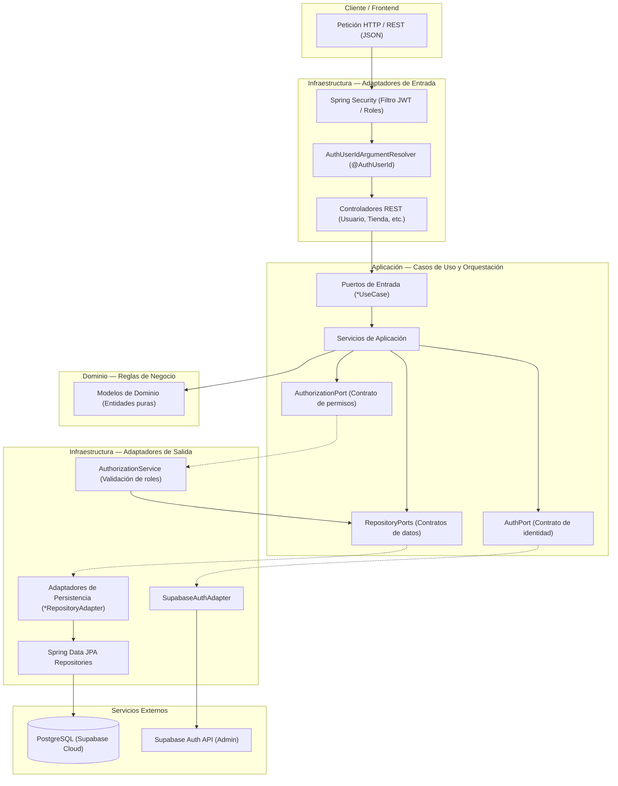

# OptiWay — Backend EBP06

<div align="center">
     <a href="https://opti-way-frontend.vercel.app/"></a> <a href="https://optiway-backend.onrender.com"></a> 

  <a href="https://optiway-backend.onrender.com/swagger-ui.html"></a> <a href="https://optiway-backend.onrender.com/graph"></a>
</div>

## Descripción General

Sistema backend para la plataforma **OptiWay**, diseñado para la gestión y optimización de la cadena de distribución logística, administración de centros de distribución (CD), gestión de tiendas comerciales, control de inventarios, registro de ingresos de mercancía y control de acceso granular basado en roles.

Desarrollado bajo los principios de **Arquitectura Hexagonal (Puertos y Adaptadores)** y **Clean Architecture** sobre el ecosistema Spring Boot y PostgreSQL (Supabase).

### Enlaces de Despliegue

* **Frontend Web (Vercel):** [https://opti-way-frontend.vercel.app/](https://opti-way-frontend.vercel.app/)
* **Backend API REST (Render):** [https://optiway-backend.onrender.com/](https://optiway-backend.onrender.com/)
* **Swagger UI (Documentación interactiva):** [https://optiway-backend.onrender.com/swagger-ui.html](https://optiway-backend.onrender.com/swagger-ui.html)


## Características

* **Gestión de Usuarios y Control de Acceso (RBAC):** Administración centralizada de usuarios con roles definidos (`ADMINISTRADOR`, `ENCARGADO_TIENDA`, `ENCARGADO_CD`, `PLANIFICADOR`), integrados con Supabase Auth y validación de tokens JWT mediante Spring Security.
* **Administración de Tiendas:** Registro de tiendas comerciales con asignación automática de códigos identificadores (`TND-XXXXXXXX`), consulta de listados y geolocalización.
* **Gestión de Centros de Distribución (CD):** Registro de centros de distribución con códigos únicos (`CD-XXXXXXXX`), cálculo y asignación de zonas de cobertura mediante relaciones con tiendas abastecidas (`@ManyToMany`).
* **Control y Consulta de Inventarios:** Monitoreo y filtros de stock por tienda, nombre, categoría y producto, con validación de accesos por rol y tienda asignada.
* **Ingreso y Recepción de Mercancía:** Trazabilidad de recepción de productos en centros de distribución con control de cantidades y origen.


## Tecnologías / Stack

* **Lenguaje:** Java 17
* **Framework Principal:** Spring Boot 4.1.1
* **Seguridad & Autenticación:** Spring Security 7 (OAuth2 Resource Server con validación JWT) y Supabase Admin Auth
* **Persistencia & ORM:** Spring Data JPA / Hibernate
* **Base de Datos:** PostgreSQL en la nube (Supabase)
* **Gestor de Construcción y Dependencias:** Apache Maven (con Maven Wrapper `mvnw`)


## Arquitectura

El proyecto organiza sus responsabilidades mediante el patrón de **Arquitectura Hexagonal (Puertos y Adaptadores)**:

```text
src/main/java/com/example/optiway/
├── domain/                  # Reglas de negocio puras e independientes de frameworks
│   └── model/               # Entidades de dominio (Usuario, Tienda, CentroDistribucion, Rol,
│                            # Inventario, Producto, IngresoMercancia, Venta)
│
├── application/             # Orquestación de casos de uso y lógica de aplicación
│   ├── exception/           # Excepciones de negocio (acceso denegado, stock, duplicados, etc.)
│   ├── port/
│   │   ├── in/              # Casos de uso / Puertos de entrada
│   │   │   └── dto/         # DTOs de respuesta de la API
│   │   └── out/             # Puertos de salida (repositorios, AuthPort, AuthorizationPort)
│   └── service/             # Implementación de casos de uso y validaciones de negocio
│
└── infrastructure/          # Adaptadores y tecnologías externas
    ├── adapter/
    │   ├── in/rest/         # Controladores REST, DTOs de entrada y manejador global de excepciones
    │   └── out/
    │       ├── auth/        # Adaptador de autenticación externa (Supabase Admin API)
    │       └── persistence/ # Entidades JPA, repositorios Spring Data y adaptadores de persistencia
    ├── config/              # Configuración del framework (Spring Security, OpenAPI, MVC)
    └── security/            # Autorización centralizada y resolución de @AuthUserId desde el JWT
```

### Flujo de la Aplicacion



Para una explicación a fondo del flujo de capas, consulta [`docs/Hexagonal-Arquitecture.md`](docs/Hexagonal-Arquitecture.md).


### Endpoints

La referencia completa de la API (métodos, roles requeridos, códigos de estado y ejemplos) está en [`docs/Swagger_OpenAPI.md`](docs/Swagger_OpenAPI.md). Para probarla directamente, entra a [Swagger UI del backend desplegado](https://optiway-backend.onrender.com/swagger-ui.html) o, en local, a [`http://localhost:8080/swagger-ui.html`](http://localhost:8080/swagger-ui.html).


## Credenciales de Desarrollo y Pruebas


| Rol | Correo Electrónico | Contraseña | Alcance / Permisos |
|---|---|---|---|
| **Administrador** | `admin@empresa.com` | `admin123` | Acceso global: administración de usuarios, catálogo maestro, tiendas y centros de distribución. |
| **Planificador** | `ana@empresa.com` | `admin123` | Consulta de inventario consolidado y supervisión de la red de abastecimiento. |
| **Encargado de Tienda** | `carlos@empresa.com` | `tienda123` | Consulta de inventario local y registro de ventas en su tienda asignada. |
| **Encargado de CD** | `roberto@empresa.com` | `cd123 ` *(con espacio final)* | Consulta de inventario y registro de ingreso de mercancía en su centro de distribución asignado. |


## Instalación y Ejecución

### Requisitos previos
* JDK 17 o superior instalado y configurado en el `PATH`.

### Compilar el proyecto
En Windows (PowerShell / CMD):
```powershell
.\mvnw.cmd clean compile
```

En Linux / macOS:
```bash
./mvnw clean compile
```

### Ejecutar el servidor Spring Boot
En Windows (PowerShell / CMD):
```powershell
.\mvnw.cmd spring-boot:run
```

En Linux / macOS:
```bash
./mvnw spring-boot:run
```

La aplicación iniciará por defecto en `http://localhost:8080`.

> La conexión a PostgreSQL (Supabase) requiere definir las variables de entorno `DB_PASSWORD` y `SUPABASE_SERVICE_ROLE_KEY` antes de arrancar.

### Pruebas

Por defecto, la suite de pruebas unitarias (JUnit 5 + Mockito) corre sobre **H2 en memoria** (`MODE=PostgreSQL`) para no depender de Supabase:

```powershell
.\mvnw.cmd test
```

También se puede ejecutar la misma suite contra la base real de **Supabase**, validando el esquema sin crear ni borrar tablas (`ddl-auto=validate`). Usa el pooler de transacciones (`6543`) con `prepareThreshold=0`:

```powershell
$env:SPRING_DATASOURCE_URL="jdbc:postgresql://aws-0-us-west-2.pooler.supabase.com:6543/postgres?prepareThreshold=0"
$env:SPRING_DATASOURCE_USERNAME=$env:DB_USER
$env:SPRING_DATASOURCE_PASSWORD=$env:DB_PASSWORD
$env:SPRING_DATASOURCE_DRIVER_CLASS_NAME="org.postgresql.Driver"
$env:SPRING_JPA_HIBERNATE_DDL_AUTO="validate"
$env:SPRING_JPA_DATABASE_PLATFORM="org.hibernate.dialect.PostgreSQLDialect"
$env:SPRING_DATASOURCE_HIKARI_MAXIMUM_POOL_SIZE="1"
$env:SPRING_DATASOURCE_HIKARI_MINIMUM_IDLE="0"
.\mvnw.cmd test
```

> Contra Supabase usa siempre `ddl-auto=validate`. Nunca `create-drop` ni `update`: podrían borrar o alterar las tablas reales.

La aplicación en ejecución siempre usa PostgreSQL (Supabase).


## Documentación complementaria

* [Swagger / OpenAPI](docs/Swagger_OpenAPI.md): catálogo completo de operaciones, códigos de estado y ejemplos.
* [DTOs y contratos de API](docs/dto/README.md): esquemas JSON y tipos TypeScript para el frontend.
* [Historias de Usuario](docs/Historias%20de%20Usuario/): especificación funcional por HU.
* [Deuda técnica](docs/deudaTecnica.md): trabajo abierto y decisiones de diseño pendientes.
* [Changelog](docs/CHANGELOG.md): resumen de los cambios relevantes por tema.
