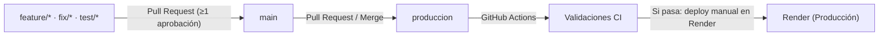

# CI/CD, Gitflow y Validaciones del Pipeline — OptiWay Backend

Este documento describe el flujo de ramas (*Gitflow*), los controles de integración y las **validaciones automatizadas** que ejecuta el pipeline de CI/CD en [`ci.yml`](../.github/workflows/ci.yml).

---

## 1. Flujo de ramas y reglas de integración

- **Protección de `main`:** exige Pull Request con **al menos 1 aprobación** de un revisor con permisos de escritura (*write access*).
- **Rama `produccion`:** dispara el pipeline de CI en cada `push`; cuando las validaciones pasan, se ejecuta el despliegue manual en Render.

---

## 2. Validaciones que ejecuta el pipeline (`CI - Producción`)

| Orden | Validación / Paso | Condición / Herramienta | Qué verifica y si bloquea |
|---|---|---|---|
| 1 | **Compilación y pruebas** | `bash ./mvnw -B verify` (JDK 17 Temurin) | Compila el proyecto y ejecuta todas las pruebas unitarias e integración sobre H2 en memoria. **Bloqueante.** |
| 2 | **Umbral de cobertura (`≥ 40%`)** | `jacoco-maven-plugin` `0.8.13` (`check-40-por-ciento` en `pom.xml`) | Valida que la cobertura mínima de líneas (`LINE COVEREDRATIO`) del módulo sea `>= 0.40` y genera `target/site/jacoco/jacoco.xml`. **Bloqueante.** |
| 3 | **Publicación de cobertura** | `actions/upload-artifact@v4` (`if: always()`) | Sube `target/site/jacoco` como artefacto `jacoco-report` para auditoría, incluso si falla un paso previo. |
| 4 | **Detección de secretos** | `gitleaks/gitleaks-action@v2` (`fetch-depth: 0`) | Escanea el historial completo de commits buscando credenciales, tokens o claves expuestas. Configurado con `continue-on-error: true` (no bloquea si el workspace requiere licencia). |
| 5 | **SCA de dependencias (opcional)** | `org.owasp:dependency-check-maven:check` (`if: vars.SCA_ENABLED == 'true'`) | Analiza dependencias contra la base NVD (`NVD_API_KEY`) en formato HTML. |
| 6 | **Quality Gate (opcional)** | `SonarSource/sonarqube-auth-action@v1` + `sonar-maven-plugin:sonar` (`if: vars.SONAR_ENABLED == 'true'`) | Autenticación OIDC *secretless* hacia SonarQube Cloud consumiendo el reporte `target/site/jacoco/jacoco.xml`. |

---

## 3. Despliegue en Render (CD)

- **Plataforma:** Render (`https://optiway-backend.onrender.com`), conectado a la rama `produccion` mediante `Dockerfile`.
- **Modo de despliegue:** **Auto-deploy desactivado** — el despliegue a Render se ejecuta manualmente desde el panel de Render sobre `produccion` una vez que las validaciones de CI pasan en GitHub Actions.
- **Verificación de salud:** `GET https://optiway-backend.onrender.com/actuator/health` → `UP`.
