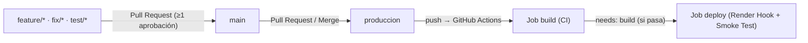

# CI/CD, Gitflow y Validaciones del Pipeline — OptiWay Backend

Este documento describe el flujo de ramas (*Gitflow*), los controles de integración y las **validaciones automatizadas** que ejecuta el pipeline de CI/CD en [`ci.yml`](../.github/workflows/ci.yml).

---

## 1. Flujo de ramas y reglas de integración

- **Protección de `main`:** exige Pull Request con **al menos 1 aprobación** de un revisor con permisos de escritura (*write access*).
- **Rama `produccion`:** dispara el workflow `CI - Producción` en cada `push` con control de concurrencia (`group: deploy-produccion`, `cancel-in-progress: false`) para no cancelar despliegues en curso.

---

## 2. Job `build` — Compilar, probar y medir cobertura

Ejecuta sobre `ubuntu-latest` (`timeout-minutes: 25`) con **Java 17 (Temurin)**, caché de Maven (`actions/setup-java@v6`), `actions/checkout@v7` (`fetch-depth: 0`) y permisos `contents: read` + `id-token: write` (para OIDC).

| Orden | Validación / Paso | Condición / Herramienta | Qué verifica y si bloquea |
|---|---|---|---|
| 1 | **Detección de secretos** | `gitleaks/gitleaks-action@v2` (`if: env.GITLEAKS_LICENSE != ''`) | Escanea el historial completo de commits buscando credenciales, tokens o claves expuestas. **Bloqueante** cuando `secrets.GITLEAKS_LICENSE` está configurado. |
| 2 | **Compilación y pruebas** | `bash ./mvnw -B -ntp verify` | Compila el proyecto y ejecuta las pruebas unitarias y de integración sobre H2 en memoria. **Bloqueante.** |
| 3 | **Cobertura (`≥ 40%` de líneas)** | Cálculo sobre `target/site/jacoco/jacoco.csv` (`COBERTURA_MINIMA: 40`) | Verifica que la cobertura de líneas sea `>= 40%` y publica el porcentaje en `$GITHUB_STEP_SUMMARY`. **Bloqueante.** |
| 4 | **Publicación de cobertura** | `actions/upload-artifact@v7` (`if: always()`) | Sube `target/site/jacoco` como artefacto `jacoco-report` para auditoría, incluso si falla un paso previo. |
| 5 | **SCA de dependencias (opcional)** | `org.owasp:dependency-check-maven:check` (`if: vars.SCA_ENABLED == 'true'`) | Analiza dependencias contra la base NVD (`secrets.NVD_API_KEY`). Configurado con `continue-on-error: true` (**informativo**, no bloquea). |
| 6 | **Quality Gate — SonarQube Cloud (opcional)** | `SonarSource/sonarqube-auth-action@v1` + `sonar-maven-plugin:sonar` (`if: vars.SONAR_ENABLED == 'true' && vars.SONAR_BOUND == 'true'`) | Autenticación OIDC *secretless* hacia SonarQube Cloud consumiendo `target/site/jacoco/jacoco.xml` con `-Dsonar.qualitygate.wait=true`. **Bloqueante** una vez activado. |

---

## 3. Job `deploy` — Despliegue automático en Render (CD)

Se ejecuta únicamente si el job `build` finaliza con éxito (`needs: build`), sobre `ubuntu-latest` (`timeout-minutes: 15`), en el entorno `environment: production` y con `permissions: {}`.

1. **Deploy Hook de Render:** envía una petición `POST` a `secrets.RENDER_DEPLOY_HOOK` y valida que la respuesta HTTP sea `2xx` (si falta el secreto o falla el hook, el job falla). Registra el estado en `$GITHUB_STEP_SUMMARY`.
2. **Smoke test (opcional):** si está definida la variable `vars.HEALTH_URL` (por ejemplo, `https://optiway-backend.onrender.com/actuator/health`), espera `30 s` iniciales y realiza hasta `20` intentos cada `15 s` (~5 min) esperando `HTTP 200`; si no responde `200`, falla el despliegue.

---

## 4. Variables y secretos requeridos en GitHub

| Tipo | Nombre | Uso |
|---|---|---|
| **Secret** | `RENDER_DEPLOY_HOOK` | URL del Deploy Hook de Render para disparar el despliegue a producción (**obligatorio** en `deploy`). |
| **Secret** | `GITLEAKS_LICENSE` | Licencia para habilitar el escaneo de secretos con Gitleaks (opcional; si no existe, el paso se omite). |
| **Secret** | `NVD_API_KEY` | API key de NVD para acelerar las consultas de OWASP Dependency-Check cuando `SCA_ENABLED == 'true'`. |
| **Variable** | `SCA_ENABLED` | `'true'` para ejecutar el análisis SCA informativo. |
| **Variable** | `SONAR_ENABLED` / `SONAR_BOUND` | Ambas en `'true'` para ejecutar autenticación OIDC y Quality Gate bloqueante en SonarQube Cloud. |
| **Variable** | `HEALTH_URL` | URL de salud para ejecutar el *smoke test* posterior al deploy en Render (opcional). |
