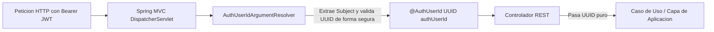

# Informe de Refactorización y Estandarización: Inyección de Identidad con @AuthUserId (Fix 7)

Este documento detalla la eliminación de código duplicado, el desacoplamiento de infraestructura y la estandarización según las mejores prácticas de **Spring Boot** y **Arquitectura Hexagonal** para la resolución e inyección del identificador del usuario autenticado (`UUID authUserId`) en la capa de controladores REST.

---

## 1. Resumen Ejecutivo y Alcance

En una aplicación con Arquitectura Hexagonal que consume tokens JWT (Supabase OAuth2):
1. **La capa de aplicación (Casos de Uso)** no debe conocer dependencias de seguridad o HTTP (como `Jwt` o headers `Authorization`), sino únicamente el identificador de identidad `UUID authUserId`.
2. **Los controladores REST** actúan como adaptadores primarios y su rol es mapear la petición HTTP hacia los casos de uso.
3. Se implementó el estándar idiomático de Spring Boot mediante un **`HandlerMethodArgumentResolver`** y una anotación personalizada **`@AuthUserId`**, eliminando la extracción manual y dispersa de JWT en los 6 controladores del proyecto.

---

## 2. Deuda Técnica y Brechas Previas al Fix

Antes de esta refactorización, el proyecto presentaba **15 puntos de extracción manual de JWT** con implementaciones dispares y riesgos de estabilidad:

| Controlador | Ocurrencias | Implementación Anterior | Riesgo / Problema |
| :--- | :---: | :--- | :--- |
| **`UsuarioController`** | 5 | `UUID.fromString(jwt.getSubject())` | 💥 Lanza `NullPointerException` o `IllegalArgumentException` (error 500) si el token o subject falla. |
| **`TiendaController`** | 3 | `jwt != null ? UUID.fromString(jwt.getSubject()) : null` | ⚠️ Verboso, uso de paquetes completos en firmas (`@org.springframework...`). |
| **`CentroDistribucionController`** | 3 | `jwt != null ? UUID.fromString(jwt.getSubject()) : null` | ⚠️ Mismo boilerplate y duplicación de lógica de verificación. |
| **`InventarioController`** | 1 | `UUID.fromString(jwt.getSubject())` | 💥 Mismo riesgo de error 500 no controlado. |
| **`IngresoMercanciaController`** | 1 | `UUID.fromString(jwt.getSubject())` | 💥 Mismo riesgo de error 500 no controlado. |
| **`ProductoController`** | 2 | Helper privado `extraerAuthUserId(jwt)` | ⚠️ Código utilitario duplicado dentro del controlador. |

---

## 3. Arquitectura de la Solución Implementada



### A. Anotación Personalizada: `@AuthUserId`
Ubicación: [AuthUserId.java](file:///c:/Users/Fixer/Desktop/Git%20Kraken/OptiWay-Backend/src/main/java/com/example/optiway/infrastructure/security/AuthUserId.java)
```java
@Target(ElementType.PARAMETER)
@Retention(RetentionPolicy.RUNTIME)
@Documented
public @interface AuthUserId {
}
```

### B. Resolvedor de Argumentos: `AuthUserIdArgumentResolver`
Ubicación: [AuthUserIdArgumentResolver.java](file:///c:/Users/Fixer/Desktop/Git%20Kraken/OptiWay-Backend/src/main/java/com/example/optiway/infrastructure/security/AuthUserIdArgumentResolver.java)
* Intercepta cualquier parámetro anotado con `@AuthUserId` cuyo tipo sea `UUID`.
* Lee de forma centralizada la autenticación en el `SecurityContextHolder`.
* Realiza el casteo seguro a `Jwt`, verifica la presencia del claim `sub` (subject) y valida su formato `UUID` dentro de un bloque protegido:
  ```java
  Object principal = authentication.getPrincipal();
  if (principal instanceof Jwt jwt && jwt.getSubject() != null) {
      try {
          return UUID.fromString(jwt.getSubject());
      } catch (IllegalArgumentException e) {
          return null;
      }
  }
  ```
* Si la autenticación es nula o el subject es inválido, inyecta `null`, permitiendo que la capa de servicio aplique su política de seguridad (`AccesoDenegadoException` -> `403 Forbidden`).

### C. Registro en Spring MVC: `WebMvcConfig`
Ubicación: [WebMvcConfig.java](file:///c:/Users/Fixer/Desktop/Git%20Kraken/OptiWay-Backend/src/main/java/com/example/optiway/infrastructure/config/WebMvcConfig.java)
* Registra el componente en la lista de resolvers de Spring MVC mediante `addArgumentResolvers`.

---

## 4. Controladores Refactorizados

Los 6 controladores fueron limpiados eliminando dependencias directas con `@AuthenticationPrincipal` y `Jwt`:

1. **[ProductoController.java](file:///c:/Users/Fixer/Desktop/Git%20Kraken/OptiWay-Backend/src/main/java/com/example/optiway/infrastructure/adapter/in/rest/ProductoController.java):**
   * Eliminado el método privado redundante `extraerAuthUserId`.
   * Endpoints `POST /api/productos` y `PATCH /api/productos/{id}` reciben `@AuthUserId UUID authUserId`.
2. **[UsuarioController.java](file:///c:/Users/Fixer/Desktop/Git%20Kraken/OptiWay-Backend/src/main/java/com/example/optiway/infrastructure/adapter/in/rest/UsuarioController.java):**
   * 5 endpoints simplificados (`crearUsuario`, `obtenerUsuarios`, `obtenerUsuarioAutenticado`, `eliminarUsuario`, `actualizarRol`).
3. **[TiendaController.java](file:///c:/Users/Fixer/Desktop/Git%20Kraken/OptiWay-Backend/src/main/java/com/example/optiway/infrastructure/adapter/in/rest/TiendaController.java):**
   * Eliminados los imports inline extensos y operadores ternarios repetidos en 3 endpoints.
4. **[CentroDistribucionController.java](file:///c:/Users/Fixer/Desktop/Git%20Kraken/OptiWay-Backend/src/main/java/com/example/optiway/infrastructure/adapter/in/rest/CentroDistribucionController.java):**
   * Simplificados endpoints de creación, listado y asignación de encargado.
5. **[InventarioController.java](file:///c:/Users/Fixer/Desktop/Git%20Kraken/OptiWay-Backend/src/main/java/com/example/optiway/infrastructure/adapter/in/rest/InventarioController.java):**
   * Endpoint `GET /api/inventario` recibe `@AuthUserId UUID authUserId`.
6. **[IngresoMercanciaController.java](file:///c:/Users/Fixer/Desktop/Git%20Kraken/OptiWay-Backend/src/main/java/com/example/optiway/infrastructure/adapter/in/rest/IngresoMercanciaController.java):**
   * Endpoint `POST /api/ingresos-mercancia` recibe `@AuthUserId UUID authUserId`.

---

## 5. Matriz Comparativa

| Criterio | Antes | Ahora |
| :--- | :--- | :--- |
| **Firma en Controlador** | `@AuthenticationPrincipal Jwt jwt` | `@AuthUserId UUID authUserId` |
| **Líneas de extracción en controllers** | 15 bloques dispersos | 0 (resuelto automáticamente por Spring) |
| **Puntos de fallo por NPE / UUID inválido** | 15 posibles excepciones 500 | 1 punto central seguro |
| **Acoplamiento de Controllers a JWT** | Fuerte (import `Jwt`) | Nulo (controladores solo ven `UUID`) |
| **Facilidad para Pruebas Unitarias** | Requiere mockear Jwt y Claims | Se pasa un `UUID` directamente |

---

## 6. Estado de Compilación

* **Herramienta:** Maven Wrapper (`mvnw compile -DskipTests`)
* **Resultado:** `BUILD SUCCESS` (75 archivos compilados)
