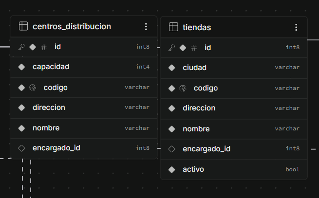

# Deuda Técnica y Decisiones Arquitectónicas Abiertas (OptiWay)

> Este documento recoge **decisiones de diseño pendientes e inconsistencias internas** del código que no son tareas de producto.
> El trabajo funcional (endpoints por conectar, features a completar) vive en las [historias de usuario](./Historias%20de%20Usuario/).
> Los cambios ya ejecutados y justificados viven en [`docs/Fix´s/`](./Fix´s/).

**Actualizado:** 21 de octubre de 2026

---

## 1. Duplicidad `save` / `guardar` en los puertos de repositorio

**Estado:** ⚠️ Activo · **Impacto:** Legibilidad / coherencia · **Esfuerzo:** Bajo (renombrado mecánico)

Todos los puertos de repositorio (`application/port/out/*RepositoryPort`) exponen **los dos nombres para la misma operación**, puenteados con un método `default`:

```java
// VentaRepositoryPort — el primario es "save", el alias es "guardar"
Venta save(Venta venta);
default Venta guardar(Venta venta) { return save(venta); }

// UsuarioRepositoryPort — el primario es "guardar", el alias es "save"
Usuario guardar(Usuario usuario);
default Usuario save(Usuario usuario) { return guardar(usuario); }
```

### Evidencia (reparto actual)

| Puerto | Método primario | Alias `default` |
| :--- | :--- | :--- |
| `TiendaRepositoryPort` | `save` | `guardar` |
| `ProductoRepositoryPort` | `save` | `guardar` |
| `InventarioRepositoryPort` | `save` | `guardar` |
| `VentaRepositoryPort` | `save` | `guardar` |
| `UsuarioRepositoryPort` | `guardar` | `save` |
| `CentroDistribucionRepositoryPort` | `guardar` | `save` |
| `IngresoMercanciaRepositoryPort` | `guardar` | `save` |

El problema no es solo el reparto 4/3: **los servicios los mezclan libremente, incluso en el mismo método**:

- `VentaService`: `inventarioRepositoryPort.save(...)` (L93) y `ventaRepositoryPort.guardar(...)` (L104).
- `IngresoMercanciaService`: `inventarioRepositoryPort.save(...)` (L103) y `ingresoRepositoryPort.guardar(...)` (L114).

Y existe código redundante por duplicación: `VentaRepositoryAdapter` implementa **también** un `guardar()` concreto que delega en `save()`, cuando el propio puerto ya lo trae como `default`.

### Opciones

- **Opción A — Unificar en `guardar` (recomendada):** el resto del lenguaje de dominio ya es español (`obtenerPorId`, `obtenerPorAuthUserId`, `registrarVenta`, `asignarEncargado`). Los puertos son contratos de dominio, no la API de Spring Data. Se elimina todo par de alias y el `guardar` redundante del adapter de Venta. Dentro de los adaptadores, `springDataJpaRepository.save(...)` **se queda como está** (es el método de Spring Data, ajeno al contrato).
- **Opción B — Unificar en `save`:** alineación con la convención de Spring Data; implica renombrar en español → inglés, más discordante con los casos de uso.

**Decisión pendiente de confirmación.** Esfuerzo estimado: ~14 archivos, rename 100% mecánico (compilación + 38 tests como red de seguridad).

---

## 2. ¿`InventarioController` propio o sub-recurso de Tienda y CD?

**Estado:** ⚠️ Abierto · **Impacto:** Coherencia de la API · **Esfuerzo:** Medio (rutas + docs; frontend casi nulo)

### Estado actual

```http
GET  /api/inventario?tiendaId={id}&nombre=&categoria=&productoId=     # tiendaId OBLIGATORIO en query
GET  /api/inventario/centro-distribucion?centroDistribucionId={id}&…  # cdId OBLIGATORIO en query
PATCH /api/inventario/{id}/stock                                      # pendiente (pendientes.md §3)
```

### El conflicto

Tras los fixes 38 y 40, la API quedó con una **regla explícita**: el identificador del *padre* va en la URL (`POST /api/tiendas/{id}/ventas`, `POST /api/centros-distribucion/{id}/ingresos`, `PUT /{id}/encargado`). Pero en inventario el id de tienda/CD viaja como **query param obligatorio**, lo que lo convierte en un identificador de recurso disfrazado de filtro — justo lo que la regla quiere evitar.

A favor de **mantenerlo propio**: en *consultas* (GET de listas), filtros en query son práctica REST estándar (`?nombre=`), y `InventarioController` es también el hogar natural del futuro `PATCH /api/inventario/{id}/stock`, cuyo `{id}` es **la fila de inventario**, no la tienda/CD.

### Opciones

- **Opción A — Anidar las lecturas (coherencia total):**
  ```http
  GET /api/tiendas/{id}/inventario?nombre=&categoria=&productoId=
  GET /api/centros-distribucion/{id}/inventario?nombre=&categoria=&productoId=
  PATCH /api/inventario/{id}/stock          # sigue propio: {id} = fila de inventario
  ```
  `InventarioController` conserva solo el `PATCH`. Costo: ajustar HU-12, HU-16, Swagger, dto/README. **El frontend `inventario.html` aún no está conectado** (pendiente §3), así que el impacto real es casi nulo: es el mejor momento para decidirlo.
- **Opción B — Mantener controller propio con query params:** las consultas son colecciones filtradas multi-rol (Admin/Planificador/Encargado) y el id obligatorio en query no rompe nadie. Costo: la API queda con dos filosofías conviviendo (path-id en transacciones, query-id en lecturas).

**Decisión pendiente de confirmación.** Recomendación tácita de la serie fix38/40: **Opción A** — si se elige, hacerlo *antes* de conectar `inventario.html` para no romper nada.

---

## 3. Cobertura de pruebas desbalanceada

**Estado:** ⚠️ Activo · **Impacto:** Regresiones silenciosas · **Esfuerzo:** Medio

La suite actual cubre inventario, ingresos, ventas, usuarios, autorización, ubicación y grafo. **Sin ninguna prueba:**

| Servicio sin tests | Operaciones expuestas |
| :--- | :--- |
| `TiendaService` | crear tienda, listar, asignar encargado |
| `CentroDistribucionService` | crear CD (capacidad), listar, asignar encargado |
| `ProductoService` | crear, editar, cambiar estado |

Son justo los servicios que ejecutan reglas de negocio (código único de tienda, aforo del CD, historial de ediciones de producto). Sugerencia: una clase por servicio siguiendo el molde de `VentaServiceTest` (Mockito + `AuthorizationService` real, como hace `UsuarioServiceTest`).

---

## 4. `codigo` de negocio en Tienda y CD: campo decorativo que no se usa

**Estado:** ⚠️ Abierto · **Impacto:** Modelo de datos + contrato de API · **Esfuerzo:** Bajo-medio

### Estado actual

`Tienda` y `CentroDistribucion` tienen un campo `String codigo` **además del `id` numérico** (que es la clave primaria real):

- Se **genera en el servicio** al crear: `TiendaService` → `"TND-" + UUID…substring(0,8)`; `CentroDistribucionService` → `"CD-" + UUID…`.
- Viaja en las respuestas (`TiendaResponse.codigo`, `CentroDistribucionResponse.codigo`) y en las columnas `codigo` de las tablas `tiendas` / `centros_distribucion` (creadas por `ddl-auto=update`).
- Aparece en 5 vistas web (`tiendas.html`, `centros-distribucion.html`, `admin.html`, `ingreso-mercancia.html`, `inventario.html`) y en `docs/dto/`.

### El problema

**Nadie lo consume.** No existe ningún endpoint ni consulta que busque por `codigo`; los `existsByCodigo(...)` de `TiendaRepositoryPort` y `CentroDistribucionJpaRepository` **no son invocados por ningún servicio** (API muerta). Es un identificador de negocio generado, guardado y mostrado… pero jamás usado para nada — un UUID acortado con prefijo, ilegible para un humano y sin valor funcional.

### Opciones

- **Opción A — Eliminar `codigo` de Tienda y CD (recomendada):** la PK numérica pasa a ser el único identificador. Tocaría: dominio (`Tienda`, `CentroDistribucion`), servicios (borrar las 2 líneas de generación), adapters y entidades JPA (quitar el mapeo), `*Response`, `existsByCodigo` muerto, 4 clases de test, 5 vistas web y docs. La columna en Supabase hay que borrarla a mano (`ALTER TABLE tiendas DROP COLUMN codigo;` + ídem `centros_distribucion`), porque `ddl-auto=update` **nunca elimina columnas**.
- **Opción B — Mantener `codigo` pero darle uso real:** exponer `GET /api/tiendas?codigo=…`, validar unicidad en la creación y volverlo la referencia legible de negocio. Implica más trabajo que eliminarlo y hoy no hay requisito que lo pida.
- **Opción C — Mantenerlo tal cual:** solo aclarar en README/docs que el identificador primario es el `id` y que `codigo` es un valor de negocio decorativo.

Nota: en `Producto` el campo equivalente **sí tiene sentido** (identificador de catálogo con el que filtra el frontend y con restricción `unique`); el caso de Tienda/CD es distinto.

---

## 5. `eliminarUsuario`: operación distribuida sin transacción (Supabase + BD local)

**Estado:** ⚠️ Abierto (decisión consciente) · **Impacto:** Consistencia de datos · **Esfuerzo:** Alto (requiere patrón de compensación)

`UsuarioService.eliminarUsuario` realiza **dos efectos que no pueden agruparse en una transacción**:

```java
if (usuarioAEliminar.getAuthUserId() != null) {
    authPort.eliminarUsuarioAuth(usuarioAEliminar.getAuthUserId()); // 1) HTTP a Supabase Auth (irreversible)
}
usuarioRepositoryPort.eliminar(id);                                 // 2) borrado en la BD local (revertible)
```

`@Transactional` sólo protege operaciones contra la base de datos; **no puede revertir una llamada HTTP** ya ejecutada contra Supabase. Por eso añadir la anotación **no elimina el problema**: lo mueve.

### Las dos ventanas de inconsistencia

| Orden | Qué falla | Resultado | ¿Recuperable? |
| :--- | :--- | :--- | :--- |
| Supabase → BD (actual) | El borrado local falla tras el de Supabase | Usuario borrado en Auth, vivo en la BD local | ❌ No: el correo queda tomado en Auth y no aparece en la BD |
| BD → Supabase (invertido) | El borrado en Supabase falla tras el local | La transacción local revierte; nada se borra en Auth | ✅ Sí: reintentable |
| BD → Supabase (invertido) | El **commit** local falla tras el de Supabase | Usuario borrado en Auth, vivo en la BD local | ❌ No |

Ningún orden elimina la ventana por completo; sólo cambia cuál es más probable. Un fix real exige un **patrón de compensación**: marcar el borrado como intención pendiente en la BD, borrar en Supabase y confirmar, con una tarea de reconciliación que reintente los borrados que quedaron a medias. Eso es infraestructura (outbox/cola + job), desproporcionada para el tamaño actual.

### Mitigación parcial disponible (no aplicada)

Invertir el orden (BD primero) y añadir `@Transactional` reduciría la ventana al caso poco frecuente de "commit local falla tras Supabase OK", porque el caso común ("Supabase caído") pasa a ser recuperable con un simple reintento. Se documenta pero **no se implementa** por decisión explícita, dado que no cierra el problema y añade complejidad.

### Relacionado

El mismo patrón de dos efectos (invitar en Supabase y luego guardar en la BD local) existe en `crearUsuario`, aunque ahí el fallo deja un usuario invitado sin registro local — menos grave porque es reintentable reutilizando la cuenta por email.

---

## 6. `Usuario`: entidad de dominio con lógica de autorización (Fat Domain)

**Estado:** ⚠️ Abierto (decisión consciente) · **Impacto:** Diseño · **Esfuerzo:** Medio

`Usuario` concentra métodos de decisión de permisos (`puedeOperarTienda`, `esEncargadoDe`, `puedeGestionarTodo`, `admiteAsignacionDeUbicacion`). Mezcla "datos del usuario" con "reglas de autorización complejas".

**Postura adoptada:** esto **no es un defecto**, es el patrón **Information Expert** (GRASP): quien tiene la información (el rol y la asignación) es quien decide. La alternativa —que cada uno de los ~7 servicios inspeccione `usuario.getRol() == X`— dispersa la regla y es peor. Que una regla nueva ("un encargado opera sólo en horario comercial") toque `Usuario` es el comportamiento **esperado** del patrón, no un síntoma.

**Límite conocido:** cuando aparezcan reglas que dependan de **contexto** (hora, ubicación física, estado de la operación) y no sólo del usuario, la decisión deja de ser responsabilidad del dominio y conviene un `Policy`/`Specification` fuera de `Usuario`. Hoy no existen esas reglas, así que no se introduce esa capa (evitar sobreingeniería). Queda como umbral documentado: **si una regla necesita datos externos al usuario, la decisión sale de la entidad.**

---

## 7. `Rol`: enum anémico y reglas dispersas

**Estado:** ⚠️ Abierto (decisión consciente) · **Impacto:** Mantenibilidad · **Esfuerzo:** Medio-Alto

`Rol` es un enum sin lógica; el "qué puede hacer cada rol" vive en `Usuario` (`puedeGestionarTodo`, `esAdministrador`) y en `AuthorizationService` (guardas). Añadir un rol nuevo obliga a tocar varios puntos.

**Postura adoptada:** el enum **debe** ser anémico; meter la lógica de permisos dentro de `Rol` sólo movería el problema y la acoplaría al enum. La dispersión es real pero acotada: los roles actuales se resuelven con **tres reglas** (`esAdministrador`, `puedeGestionarTodo`, `esEncargadoDe`), no con una regla por rol.

**Cuándo revisar:** si se añade un rol con un perfil de permisos que no encaje en las tres reglas (el ejemplo típico: `AUDITOR` de sólo lectura), conviene introducir una tabla de capacidades por rol (p. ej. `Rol` con un `Set<Capacidad>` o un `Map<Rol, Set<Permiso>>`) en lugar de seguir añadiendo métodos `esX()`. Mientras los roles encajen en las tres reglas, la tabla de capacidades es infraestructura innecesaria.

---

## 8. Cardinalidad de roles, encargados y ubicaciones (regla no explicitada)

**Estado:** ⚠️ Abierto · **Impacto:** Diseño / Integridad de datos · **Esfuerzo:** Bajo-Medio

### Estado actual

El modelo actual implica reglas cardinales que **no están formalizadas** ni validadas explícitamente:

| Relación | ¿Cómo está hoy? | ¿Se valida? |
| :--- | :--- | :--- |
| **Usuario → Rol** | Un usuario tiene **un solo** `Rol` (`Usuario.rol`). | Implícito (campo único). |
| **Usuario → Tiendas** | Un encargado puede estar asignado a **una o varias** tiendas vía `Tienda.encargadoId` (sin restricción `UNIQUE`). | No. El esquema permite asignar el mismo usuario a distintas tiendas. |
| **Usuario → Centros de Distribución** | Igual que tiendas: `CentroDistribucion.encargadoId` permite **uno o varios** CD por usuario. | No. Sin restricción. |
| **Tienda → Encargado** | Una tienda puede tener **un encargado** asignado (`encargadoId` nullable). | No hay restricción `UNIQUE` que impida reutilizar al mismo encargado. |
| **CD → Encargado** | Un CD puede tener **un encargado** asignado (`encargadoId` nullable). | Ídem. |
| **Usuario distinto a encargado** | `Usuario.admiteAsignacionDeUbicacion()` limita quién puede recibir una asignación. | Sí, existe esa regla. |

### Preguntas a resolver

- **¿Un usuario puede tener más de un rol?** ¿O debe seguir siendo **un rol por usuario**? Pasar a múltiples roles cambiaría sustancialmente la autorización.
- **¿Un usuario puede gestionar más de una tienda o más de un CD?** Si sí, `AuthorizationService.requirePermisoTienda` debe pasar de "su tienda" a **conjunto de tiendas asignadas**. Si no, hay que aplicar la restricción.
- **¿Una tienda o un CD pueden tener más de un encargado simultáneamente?** Si se permite, hay que definir igualdad de permisos, jerarquía o encargado principal. Hoy es **0..1** por intención, pero **no está forzado**.
- **¿Puede un mismo usuario ser encargado de una tienda y, a la vez, de un CD?** El esquema lo permite hoy. ¿Es correcto o debe prohibirse?

### Decisión pendiente

**Definir y formalizar la cardinalidad explícitamente.** Según la respuesta:

- **Mantener 1:1 (encargado ↔ tienda/CD):** añadir validaciones en aplicación + `UNIQUE (encargadoId)` en `tiendas` y `centros_distribucion` (teniendo en cuenta `NULL`).
- **Permitir 1:N:** refactorizar autorización para trabajar con **colecciones de ubicaciones** en `AuthorizationService` y en el dominio.
- **Múltiples roles:** rediseñar `Usuario.rol` a relación, actualizar enum/autorización y migraciones.

**Postura actual:** el código asume **un rol por usuario** y permite **asignaciones múltiples** sin validar. Esto debe aclararse antes de añadir más reglas o restricciones en base de datos.

---

## 9. Logging: guía teórica sin implementación real

**Estado:** ⚠️ Abierto · **Impacto:** Observabilidad / diagnóstico en producción · **Esfuerzo:** Bajo-Medio

El proyecto **no tiene una política de logging definida**. Hoy solo existe:

- `spring.jpa.show-sql=true` y `format_sql=true` en `application.properties` (SQL por consola).
- `log.error` en `ApiExceptionHandler.errorInesperado` para excepciones no controladas.
- El logging por defecto de Spring Boot (SLF4J + Logback, nivel `INFO`, solo consola).

El antiguo `docs/Sistema-de-Logs.md` era una guía genérica (niveles, `CommonsRequestLoggingFilter`, logging manual, rotación de archivos, buenas prácticas). No describía una implementación existente del proyecto, así que se eliminó para no confundirla con el estado real.

**Pendiente:**
- Definir niveles por entorno: `DEBUG` local (web/security/SQL) e `INFO` o `WARN` en producción.
- Sacar `show-sql` de producción o moverlo a un logger específico.
- Loguear peticiones sin volcar tokens JWT ni datos sensibles.
- Evaluar formato estructurado (JSON) si se consume desde Render u otra herramienta de observabilidad.
- En Render, priorizar stdout; añadir rotación/archivo solo si se necesita retención local.

---



---

## 10. Documentación de reglas de autorización de negocio en OpenAPI / Swagger

**Estado:** ⚠️ Abierto · **Impacto:** Fricción de integración frontend/backend · **Esfuerzo:** Bajo-Medio

### El problema

OpenAPI / Swagger UI documenta actualmente solo la **firma sintáctica de los endpoints** (parámetros de URL, formato del request body y esquema de seguridad `bearerAuth`), pero **no expone las reglas de autorización de negocio** aplicadas en la capa de servicios (`AuthorizationService`, `TiendaSecurity`, `MatrizPermisosTest`):

- Por ejemplo, en `POST /api/tiendas/{id}/ventas`, el esquema indica que requiere autenticación y un `id` numérico en la URL, pero **no declara** que un usuario con rol `ENCARGADO_TIENDA` solo puede registrar ventas en la tienda específica a la que fue asignado (`tienda.encargadoId == authUserId`), y que intentar operar en otra tienda devuelve un `403 Forbidden`.
- Esto provoca que los clientes (frontend o integradores externos) asuman que tener el rol es suficiente para operar en cualquier recurso, descubriendo las restricciones de pertenencia o tenencia recién al recibir errores `403` en tiempo de ejecución.

### Estrategias de solución identificadas

1. **Documentar códigos de error y restricciones en `@Operation` y `@ApiResponse` (Opción directa e inmediata):**
   Aprovechar el soporte de Markdown en la descripción de `@Operation` y tipar el `403` con su causa de negocio:
   ```java
   @PostMapping("/{id}/ventas")
   @ResponseStatus(HttpStatus.CREATED)
   @Operation(
       summary = "Registrar venta en tienda",
       description = """
           Registra una transacción de venta descontando stock inmediatamente.
           
           **Reglas de autorización de negocio:**
           * **ADMINISTRADOR / PLANIFICADOR:** Pueden registrar ventas en *cualquier* tienda.
           * **ENCARGADO_TIENDA:** Únicamente puede vender en la tienda donde está asignado (`tienda.encargadoId == authUserId`). Si el `id` en la URL es de otra tienda, responderá `403`.
           * **ENCARGADO_CD:** Acceso denegado (`403`).
           """
   )
   @ApiResponses(value = {
       @ApiResponse(responseCode = "201", description = "Venta registrada con éxito"),
       @ApiResponse(responseCode = "400", description = "Stock insuficiente, producto inactivo o formato de fecha inválido"),
       @ApiResponse(
           responseCode = "403", 
           description = "Acceso denegado: El usuario no tiene rol autorizado o intenta operar en una tienda que no tiene asignada"
       ),
       @ApiResponse(responseCode = "404", description = "La tienda o el producto no existen")
   })
   public VentaResponse registrarVenta(...) { ... }
   ```

2. **Usar extensiones de OpenAPI (`x-roles` / `x-permissions`):**
   Declarar metadatos legibles por herramientas o pipelines cliente usando propiedades `x-`:
   ```java
   @Operation(
       summary = "Registrar venta",
       extensions = {
           @Extension(name = "security-rules", properties = {
               @ExtensionProperty(name = "allowed-roles", value = "ADMINISTRADOR, PLANIFICADOR, ENCARGADO_TIENDA"),
               @ExtensionProperty(name = "scope", value = "OWN_STORE_ONLY")
           })
       }
   )
   ```

3. **Crear anotaciones personalizadas compuestas (DRY & Clean):**
   Unificar la regla de seguridad de Spring Security y la documentación de OpenAPI en una sola meta-anotación:
   ```java
   @Target({ElementType.METHOD})
   @Retention(RetentionPolicy.RUNTIME)
   @PreAuthorize("hasAnyRole('ADMINISTRADOR', 'PLANIFICADOR') or @tiendaSecurity.isEncargado(#id, authentication)")
   @Operation(description = "🔒 **Restricción:** Solo administradores o el encargado asignado a esta tienda específica.")
   @ApiResponse(responseCode = "403", description = "No autorizado para operar en esta tienda.")
   public @interface RequireAssignedStoreOrAdmin {
   }
   ```
   En el controlador:
   ```java
   @PostMapping("/{id}/ventas")
   @RequireAssignedStoreOrAdmin
   public VentaResponse registrarVenta(...) { ... }
   ```

4. **Automatización con `OpenApiCustomizer` en `OpenApiConfig.java`:**
   Implementar un bean `OpenApiCustomizer` que inspeccione `@PreAuthorize` o anotaciones de seguridad al arrancar la aplicación e inyecte dinámicamente en el Swagger UI la lista de permisos requeridos por cada ruta.

---

## 11. Generación de tipos cliente desde OpenAPI: ventajas, problemas y limitaciones

**Estado:** ⚠️ Abierto / En adopción · **Impacto:** DX y robustez de integración · **Esfuerzo:** Bajo-Medio

### Contexto

El frontend ha incorporado un script (`scripts/gen-api.mjs`) que descarga el contrato JSON de `/v3/api-docs` y genera tipos TypeScript estáticos (`src/api/schema.d.ts`) usando `openapi-typescript`.

### Ventajas de adoptar tipos generados desde OpenAPI

1. **Eliminación de discrepancias en nombres de campos y rutas:** Cualquier desalineación de endpoints (ej. llamar a `/api/ventas` en lugar de `/api/tiendas/{id}/ventas`) o de propiedades (ej. `precio` vs `price`) genera un error de TypeScript en tiempo de compilación antes de llegar a pruebas manuales.
2. **Refactorizaciones seguras en el backend:** Cambios en los DTOs de Spring Boot se propagan mecánicamente al frontend al ejecutar `npm run gen-api`.
3. **Reducción de código duplicado:** Evita mantener interfaces manuales paralelas (`BackendUsuario`, `BackendTienda`, etc.) en cada servicio.

### Problemas y limitaciones identificadas

1. **Dependencia de red y servidor activo para regenerar:** El script requiere que el backend (local o en Render) esté encendido para consultar `/v3/api-docs`. En cold starts de Render o trabajo offline, la generación falla si no se versiona una copia local `docs/openapi.json`.
2. **Riesgo con `propertiesRequiredByDefault: true`:** SpringDoc no marca automáticamente campos como `required` a menos que tengan Bean Validation (`@NotNull`). Forzar que todas las propiedades sean requeridas por defecto en `openapiTS` puede provocar que campos que admiten `null` (como `encargadoId` o `asignacion`) se tipen como siempre presentes, ocultando posibles `NullPointerException` en el frontend.
3. **Validación estática vs runtime:** Los archivos `.d.ts` solo aplican en tiempo de compilación. Si la API en producción cambia sin regenerar los tipos en el cliente, la aplicación puede fallar silenciosamente en ejecución si no se complementa con validación en runtime (ej. Zod).
4. **Cero visibilidad de autorización y reglas de negocio:** El tipado generado describe la estructura del JSON pero ignora por completo permisos de usuario y reglas de pertenencia (documentadas en el ítem 10).

---

## 12. Declarar respuestas de error (`@ApiResponse`) en los controladores

**Estado:** ⚠️ Abierto · **Impacto:** Contrato de API para frontend e integradores · **Esfuerzo:** Medio

### El problema

Los controladores documentan con `@Operation` y `@Tag`, pero **ninguno declara `@ApiResponse`**. En `/v3/api-docs` y Swagger UI solo se ven las respuestas exitosas y el esquema genérico; no aparecen los códigos de error (`400`, `401`, `403`, `404`, `409`, `415`, `500`, `502`) ni su formato real.

Además, la API emite tres formatos de error distintos (documentados en [`docs/dto/README.md` §6](./dto/README.md#6-errores)): `ErrorResponse`, el error por defecto de Spring Boot y respuestas sin body. Swagger no refleja ninguno de forma explícita.

### Estrategia propuesta

Declarar por endpoint las respuestas de error relevantes, reutilizando el esquema `ErrorResponse`:

```java
@ApiResponses(value = {
    @ApiResponse(responseCode = "200", description = "OK"),
    @ApiResponse(responseCode = "400", description = "Solicitud inválida",
        content = @Content(schema = @Schema(implementation = ErrorResponse.class))),
    @ApiResponse(responseCode = "403", description = "Sin permisos",
        content = @Content(schema = @Schema(implementation = ErrorResponse.class))),
    @ApiResponse(responseCode = "404", description = "Recurso no encontrado",
        content = @Content(schema = @Schema(implementation = ErrorResponse.class)))
})
```

Incluir una nota para los casos sin body (`401`/`403` de Spring Security y `404` de `/graph`), que no siguen el esquema `ErrorResponse`.

### Criterio de cierre

- Cada controlador declara los códigos de error que realmente puede devolver.
- Swagger UI muestra `ErrorResponse` para los errores con body.
- Se documenta explícitamente qué endpoints pueden responder sin body.

---

## Cómo mantener este documento

- Este documento recoge **sólo deuda abierta y decisiones de diseño pendientes**. Lo resuelto **no se mantiene aquí**: se documenta en [`docs/Fix´s/`](./Fix´s/) y se elimina de esta lista.
- Cada ítem lleva **estado** (`⚠️ Abierto` / `🔄 En curso`), impacto y esfuerzo.
- Cuando una decisión se ejecute, se documenta en el fix correspondiente y se **retira** de aquí; no se deja como "resuelto".

